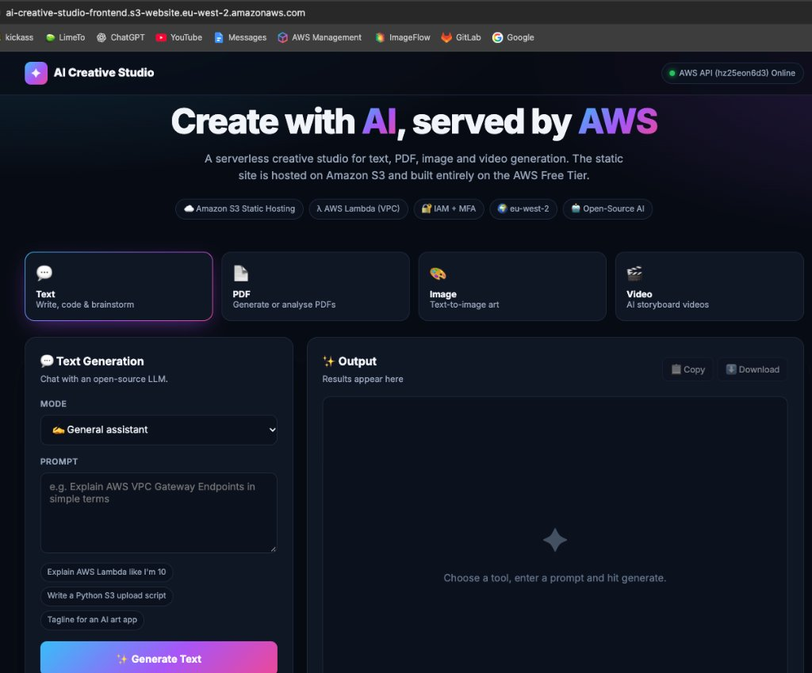
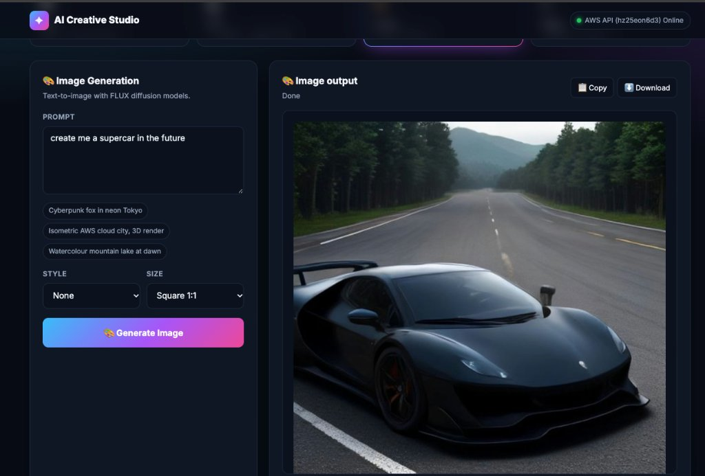
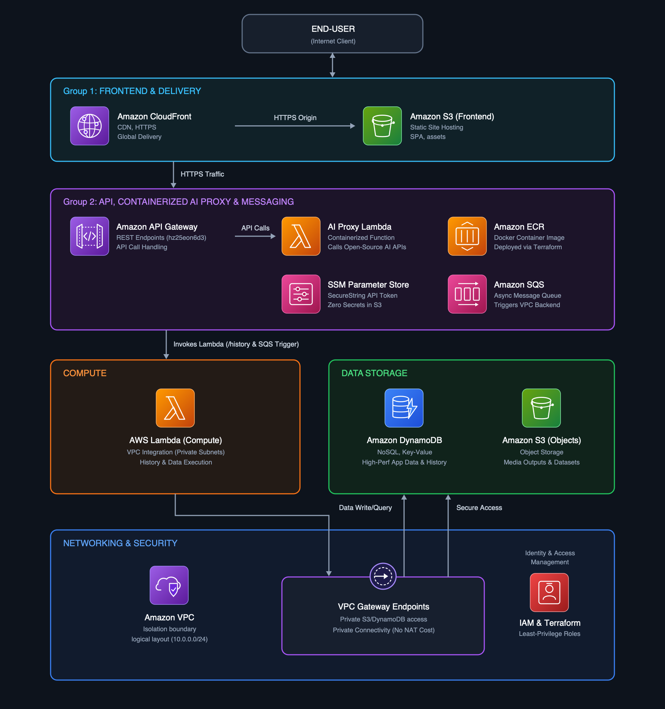

# AI Creative Studio — Serverless AWS + Open-Source AI Platform

🌐 **[Live S3 Website Demo (`eu-west-2`)](http://ai-creative-studio-frontend.s3-website.eu-west-2.amazonaws.com)** &nbsp;|&nbsp; 📄 **[Complete 81-Page Engineering & Verification Portfolio PDF (`AI-Creative-Studio-AWS-Cloud.pdf`)](./AI-Creative-Studio-AWS-Cloud.pdf)**

A security-first, **100% AWS Free-Tier (\$0.00/month)** serverless AI application built in **`eu-west-2` (London)**. The platform delivers a **4-in-1 Creative Studio** (**Text Generation**, **PDF Generator & Analyzer**, **Image Generation**, and **Storyboard WebM Video Generation**) backed by a custom multi-AZ VPC, dual AWS Lambda functions, Amazon SQS event decoupling, private DynamoDB persistence via Gateway VPC Endpoints, Docker containerization (Amazon ECR), and Infrastructure as Code (Terraform).

---

## Live Application Preview (4-in-1 AI Creative Studio)





---

## AWS Architecture & Service Landscape



---

## Key Architectural Highlights

| Engineering Pillar | Implementation Details |
| :--- | :--- |
| **Zero Secrets in the Browser** | The static S3 SPA (`FrontEnd/index.html`) contains zero API keys. Third-party AI credentials are stored encrypted at rest in **AWS Systems Manager (SSM) Parameter Store (`SecureString`)**. |
| **Dual-Lambda & Zero NAT Spend (\$0.00/mo)** | `ai-creative-studio-ai-proxy-fn` runs **outside the VPC** for free outbound internet access to SSM and external AI APIs (Hugging Face + keyless Pollinations fallback), while `ai-creative-studio-backend-fn` runs strictly inside **Private Subnets A & B** (`10.0.0.64/26`, `10.0.0.192/26`)—eliminating the need for a \$32+/month NAT Gateway. |
| **Event-Driven SQS Decoupling** | After serving an inference request, the AI Proxy publishes job metadata asynchronously to **Amazon SQS (`ai-creative-studio-jobs-queue`)**, which triggers the private VPC Lambda to persist records without adding database latency to user responses. |
| **Private VPC Data Persistence** | The private VPC Lambda writes and queries session history in **Amazon DynamoDB (`ai-creative-studio-history`, `1 RCU / 1 WCU`, 30-day TTL)** exclusively over the AWS internal network via a **Gateway VPC Endpoint (`vpce-0e1731583522bc46a`)**. |
| **Least-Privilege IAM** | Broad `FullAccess` policies are replaced with resource-scoped inline policies (`dynamodb:PutItem`, `dynamodb:Query`, `sqs:SendMessage`, `sqs:ReceiveMessage`, `ssm:GetParameter`). |
| **Docker, Amazon ECR & Terraform IaC** | Both frontend (`nginx:alpine`) and AI Proxy (`public.ecr.aws/lambda/python:3.12`) are containerized for local RIE testing, pushed to a private **Amazon ECR** repository (`187.35 MB` < 500 MB Free Tier), and codified in **Terraform** (`terraform/`). |

---

## End-to-End Request Flow

```text
Browser (S3 Static Website: ai-creative-studio-frontend, zero secrets)
   │
   └──► Amazon API Gateway REST API (ai-creative-studio-api / stage: dev)
          │
          ├── POST /api/generate/text  ──┐
          ├── POST /api/generate/image ──┴─► ai-creative-studio-ai-proxy-fn (Outside VPC, 29s timeout)
          │                                     ├── Reads /ai-creative-studio/hf-token (SSM SecureString)
          │                                     ├── Calls Hugging Face API (with Pollinations fallback)
          │                                     └── Publishes log event ──► Amazon SQS (ai-creative-studio-jobs-queue)
          │                                                                        │
          │                                                                        ▼ (Lambda Trigger)
          ├── GET /api/health  ─────────────────────────────────────────► ai-creative-studio-backend-fn
          └── GET /api/history ─────────────────────────────────────────► (Private Subnets A & B, 10s timeout)
                                                                                   │
                                                                                   ▼ (VPC Gateway Endpoint)
                                                                          Amazon DynamoDB (ai-creative-studio-history)
```

---

## Repository Structure

```text
├── Architecture/                       # VPC & Service Landscape architecture diagrams
├── FrontEnd/
│   ├── index.html                      # 4-in-1 AI Creative Studio SPA (Text, PDF, Image, Video)
│   └── Dockerfile                      # Nginx Alpine container for local frontend hosting (:8080)
├── ai-creative-studio-backend/
│   ├── ai_proxy/
│   │   ├── lambda_function.py          # External AI Proxy handler (SSM + HF/Pollinations + SQS)
│   │   └── Dockerfile                  # AWS Lambda Python 3.12 container image (:9000 RIE & ECR)
│   └── history/
│       └── lambda_function.py          # Private VPC handler (SQS consumer + DynamoDB via VPCE)
├── terraform/
│   ├── providers.tf                    # AWS Provider (~> 5.0, eu-west-2) & default project tags
│   ├── variables.tf                    # Input variables for VPC, DynamoDB, SQS, ECR, and S3
│   ├── main.tf                         # 16 declarative AWS infrastructure resources
│   └── outputs.tf                      # Exported VPC, Subnet, DynamoDB, SQS, ECR, and S3 endpoints
├── docker-compose.yml                  # Multi-container local orchestration (Frontend + Lambda RIE)
├── AI-Creative-Studio-AWS-Cloud.pdf    # Complete 81-page step-by-step engineering & verification PDF
├── SECTION6_DOCUMENTATION.md           # Section 6 documentation (AI Proxy, SSM, SQS & DynamoDB)
└── SECTION7_DOCUMENTATION.md           # Section 7 documentation (Docker, Amazon ECR & Terraform)
```

---

## Quickstart 1: Run Locally with Docker Compose

Build and start both the Nginx frontend (`http://localhost:8080`) and the AWS Lambda Runtime Interface Emulator (`http://localhost:9000`):

```bash
docker compose up -d --build
```

Test the containerized AI Proxy Lambda locally:

```bash
curl -s -X POST "http://localhost:9000/2015-03-31/functions/function/invocations" \
  -d '{"httpMethod":"POST","path":"/api/generate/text","body":"{\"messages\":[{\"role\":\"user\",\"content\":\"Say hello from Docker in 5 words\"}],\"sessionId\":\"docker-local-test\"}"}'
```

---

## Quickstart 2: Validate Infrastructure as Code (Terraform)

Initialize the `hashicorp/aws` provider, validate syntax, and run a read-only dry-run execution plan:

```bash
cd terraform
terraform init
terraform validate
terraform plan
```

---

## Author

**Huseyin Berik** — Cloud & DevOps Engineering Portfolio (`eu-west-2`)
